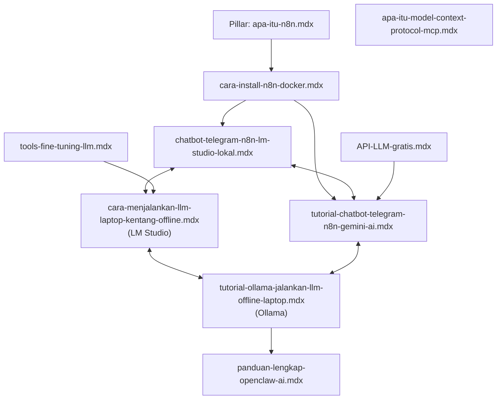

# Analisis Audit SEO & Rekomendasi Ide Artikel Strategis (KodeMinggo)

Laporan ini menyajikan audit SEO mendalam terhadap 10 artikel yang ada di direktori `_posts` serta rekomendasi 10 ide artikel baru berbasis **Search Intent** dan **Keyword Research** untuk memperkuat *domain authority* KodeMinggo di bidang AI lokal, otomatisasi workflow (n8n), MCP (Model Context Protocol), dan pengembangan AI.

---

## 1. Audit SEO & Profil Intent Artikel Saat Ini

Saat ini blog memiliki 10 artikel mdx yang membentuk 3 klaster topik utama (Topic Clusters). Berikut adalah pemetaan kata kunci fokus, intensi pencarian (*Search Intent*), dan audit singkat untuk masing-masing artikel:

| No | File Artikel & Link | Judul | Inferred Focus Keyword | Search Intent | Status & Catatan SEO |
| :--- | :--- | :--- | :--- | :--- | :--- |
| 1 | [apa-itu-model-context-protocol-mcp.mdx](file:///d:/Projek/Projek%20Pribadi/PBP/_posts/apa-itu-model-context-protocol-mcp.mdx) | Apa itu Model Context Protocol (MCP)? Penjelasan lengkap, pengertian, fungsi dan arsitektur | `model context protocol mcp` / `apa itu mcp ai` | **Informational** | Struktur H2-H3 bagus. Memiliki analogi visual yang kuat. Peluang internal link ke artikel implementasi MCP. |
| 2 | [API-LLM-gratis.mdx](file:///d:/Projek/Projek%20Pribadi/PBP/_posts/API-LLM-gratis.mdx) | API LLM Gratis Terbaik 2026 (Tanpa Kartu Kredit & Siap Pakai) | `api llm gratis` / `free api key llm` | **Commercial Investigation** | Artikel sangat lengkap dengan kode Python. Bagus untuk menarik traffic developer. Link eksternal ke provider sudah lengkap. |
| 3 | [cara-install-n8n-docker.mdx](file:///d:/Projek/Projek%20Pribadi/PBP/_posts/cara-install-n8n-docker.mdx) | Cara Install n8n Self-Hosted di Docker Desktop untuk Otomatisasi Workflow & AI Gratis | `cara install n8n docker` | **Transactional** (Tutorial) | Target kata kunci yang sangat spesifik. Perlu internal link ke artikel chatbot n8n untuk retensi pembaca. |
| 4 | [apa-itu-n8n.mdx](file:///d:/Projek/Projek%20Pribadi/PBP/_posts/apa-itu-n8n.mdx) | Apa Itu n8n? Panduan Lengkap Workflow Automation untuk Pemula | `apa itu n8n` / `n8n Indonesia` | **Informational** (Pilar) | Bertindak sebagai Artikel Pilar. Sudah merujuk ke perbandingan Zapier dan Make. Perlu di-link dari semua artikel tutorial n8n. |
| 5 | [cara-menjalankan-llm-laptop-kentang-offline.mdx](file:///d:/Projek/Projek%20Pribadi/PBP/_posts/cara-menjalankan-llm-laptop-kentang-offline.mdx) | Cara Menjalankan LLM di Windows Tanpa Internet Menggunakan LM Studio | `cara menjalankan llm offline` / `lm studio windows` | **Transactional** | Kata kunci "laptop kentang" sangat relevan dengan pasar Indonesia. Bagus untuk menjaring audiens lokal. |
| 6 | [chatbot-telegram-n8n-lm-studio-lokal.mdx](file:///d:/Projek/Projek%20Pribadi/PBP/_posts/chatbot-telegram-n8n-lm-studio-lokal.mdx) | Cara Membuat Chatbot Telegram dengan n8n & LM Studio (AI Lokal Tanpa Coding) | `chatbot telegram n8n lm studio` | **Transactional** | Detail teknis sangat baik (docker setup + ngrok). Memiliki diagram arsitektur. Internal link ke LM Studio & n8n docker sudah ada. |
| 7 | [panduan-lengkap-openclaw-ai.mdx](file:///d:/Projek/Projek%20Pribadi/PBP/_posts/panduan-lengkap-openclaw-ai.mdx) | Panduan Lengkap OpenClaw AI: Apa Itu dan Cara Set-up Lengkap | `panduan openclaw ai` / `cara setup openclaw` | **Transactional** | Membahas topik mutakhir (WSL installation, OpenRouter API). Konten sangat unik dan jarang dibahas blog lokal lain. |
| 8 | [tools-fine-tuning-llm.mdx](file:///d:/Projek/Projek%20Pribadi/PBP/_posts/tools-fine-tuning-llm.mdx) | Tools Fine-Tuning LLM: Open Source dan Gratis (2026) | `tools fine-tuning llm` | **Informational** / **Commercial** | Mengulas Unsloth, Axolotl, LLaMA-Factory. Merupakan pintu masuk traffic yang mencari solusi kustomisasi model AI. |
| 9 | [tutorial-chatbot-telegram-n8n-gemini-ai.mdx](file:///d:/Projek/Projek%20Pribadi/PBP/_posts/tutorial-chatbot-telegram-n8n-gemini-ai.mdx) | Tutorial Lengkap Membuat Chatbot Telegram dengan n8n dan Gemini AI Tanpa Coding | `chatbot telegram n8n gemini` | **Transactional** | Memperkuat klaster n8n. Memanfaatkan API Gemini gratis. Menawarkan alternatif cloud yang ringan dibanding LM Studio lokal. |
| 10 | [tutorial-ollama-jalankan-llm-offline-laptop.mdx](file:///d:/Projek/Projek%20Pribadi/PBP/_posts/tutorial-ollama-jalankan-llm-offline-laptop.mdx) | Cara Menjalankan LLM di Laptop Tanpa Internet menggunakan Ollama | `cara menjalankan llm laptop` / `tutorial ollama` | **Transactional** | Memperkuat klaster Local AI. Menjelaskan CLI setup. Bagus untuk dibandingkan dengan LM Studio yang berbasis GUI. |

---

## 2. Struktur Internal Linking & Silo Strategis

Untuk meningkatkan SEO peringkat klaster (*Topic Clusters*), semua artikel di atas harus saling terhubung melalui struktur Silo yang logis. Skema interlinking berikut direkomendasikan untuk diterapkan di dalam dokumen MDX:

> [!NOTE]
> **Action Item**: Pastikan di bagian akhir artikel "LM Studio" terdapat link rekomendasi menuju artikel "Ollama", begitu pula di akhir artikel "Tutorial Chatbot Gemini" diarahkan menuju "Chatbot LM Studio" sebagai alternatif lokal. Gunakan anchor text spesifik (misalnya: *"Jika Anda mencari solusi berbasis Command Line Interface, baca [Cara Menjalankan LLM menggunakan Ollama di Laptop](/posts/tutorial-ollama-jalankan-llm-offline-laptop)"*).

---

## 3. Rekomendasi Ide Artikel Baru Berbasis Keyword Intent (Content Gaps)

Berikut adalah 10 rekomendasi ide artikel yang ditargetkan untuk mengisi kekosongan topik (*content gaps*) pada klaster n8n, Local AI, MCP, dan Fine-Tuning. Setiap artikel dirancang berdasarkan kata kunci berbahasa Indonesia dengan volume pencarian potensial tinggi dan tingkat persaingan rendah-sedang.

### Klaster A: Otomatisasi & Workflow (n8n)

#### 1. Cara Hosting n8n Self-Hosted di VPS Murah / Gratis
*   **Kata Kunci Fokus**: `hosting n8n gratis`, `install n8n di vps`
*   **Target Search Intent**: **Transactional (Do)**
*   **Rasional Strategis**: Pengguna yang telah berhasil menginstal n8n di Docker Desktop (lokal) pasti membutuhkan solusi agar workflow berjalan 24 jam penuh tanpa membiarkan PC/laptop menyala terus.
*   **Struktur Outline Judul (H2/H3)**:
    *   ## Mengapa n8n Membutuhkan VPS? (Masalah n8n Lokal di Docker)
    *   ## Rekomendasi VPS Murah untuk Host n8n (Oracle Cloud Free Tier, DigitalOcean, Hetzner)
    *   ## Persiapan Sebelum Deployment (Domain/Subdomain & DNS Setup)
    *   ## Cara Install n8n di VPS menggunakan Docker Compose & SSL Let's Encrypt
    *   ## Menjaga Kemanan server n8n Anda (Konfigurasi Basic Auth & Firewall)

#### 2. Tutorial Membuat Bot WhatsApp dengan n8n (WhatsApp Cloud API Resmi)
*   **Kata Kunci Fokus**: `tutorial bot whatsapp n8n`, `cara membuat bot whatsapp n8n`
*   **Target Search Intent**: **Transactional (Do)**
*   **Rasional Strategis**: Di Indonesia, pangsa pasar WhatsApp jauh melebihi Telegram. Pembuatan chatbot WhatsApp otomatis memiliki daya tarik komersial tinggi untuk UMKM.
*   **Struktur Outline Judul (H2/H3)**:
    *   ## Keunggulan Bot WhatsApp n8n Dibanding Chatbot Telegram
    *   ## Persiapan WhatsApp Business Cloud API (Meta Developer Console)
    *   ## Cara Menghubungkan Webhook WhatsApp ke n8n
    *   ## Desain Node Workflow n8n untuk Membalas Pesan WhatsApp Otomatis
    *   ## Menambahkan Fitur AI (Gemini/Ollama) ke Bot WhatsApp n8n

#### 3. Cara Otomatisasi Google Sheets ke n8n dengan AI Form Agent
*   **Kata Kunci Fokus**: `otomatisasi google sheets n8n`, `n8n google sheets ai`
*   **Target Search Intent**: **Transactional (Do)**
*   **Rasional Strategis**: Banyak tim operasional menggunakan spreadsheet untuk CRM sederhana atau database leads. Otomatisasi dengan AI dapat mempercepat entri data.
*   **Struktur Outline Judul (H2/H3)**:
    *   ## Mengapa Menghubungkan Google Sheets dengan n8n?
    *   ## Cara Setup Kredensial Google Service Account di n8n
    *   ## Tutorial Membaca dan Menulis Data Google Sheets Secara Otomatis
    *   ## Integrasi AI Agent untuk Menyaring dan Kategorisasi Data di Spreadsheet
    *   ## Contoh Use Case: Klasifikasi Feedback Pelanggan Otomatis

---

### Klaster B: Model Context Protocol (MCP)

#### 4. Cara Membuat MCP Server Sendiri Menggunakan Python & Node.js
*   **Kata Kunci Fokus**: `cara membuat mcp server`, `mcp server tutorial python`
*   **Target Search Intent**: **Transactional (Do)**
*   **Rasional Strategis**: Menjembatani artikel teori "Apa itu MCP" yang sudah ada. Artikel ini ditujukan untuk developer tingkat menengah-lanjut yang ingin membuat Claude Desktop dapat mengakses data internal mereka (seperti database lokal).
*   **Struktur Outline Judul (H2/H3)**:
    *   ## Mengapa Membuat Custom MCP Server?
    *   ## Setup Project Environment (Python/TypeScript)
    *   ## Menulis Kode MCP Server Pertama untuk Membaca File Lokal
    *   ## Menghubungkan Custom MCP Server ke Claude Desktop (Konfigurasi `claude_desktop_config.json`)
    *   ## Cara Debugging dan Testing MCP Server

#### 5. Daftar Server MCP Open Source Terbaik untuk Produktivitas Claude Desktop
*   **Kata Kunci Fokus**: `server mcp terbaik`, `claude desktop mcp list`
*   **Target Search Intent**: **Commercial Investigation (Investigate)**
*   **Rasional Strategis**: Pengguna Claude Desktop ingin memperluas kemampuan AI mereka tetapi tidak ingin menulis kode sendiri. Daftar referensi server siap pakai sangat dicari.
*   **Struktur Outline Judul (H2/H3)**:
    *   ## Apa Saja Kemampuan Tambahan Claude Desktop dengan MCP?
    *   ## 7 Server MCP Open Source Wajib Pasang (SQLite, GitHub, Filesystem, Puppeteer)
    *   ## Panduan Cara Instalasi Server MCP dari Github Registry
    *   ## Cara Mengamankan Hak Akses File Saat Menggunakan Server MCP Filesystem
    *   ## Troubleshooting: Mengatasi Claude Desktop yang Gagal Loading Setelah Pasang MCP

---

### Klaster C: Local AI & RAG (Retrieval-Augmented Generation)

#### 6. Cara Membuat Private RAG Offline di Laptop (Tanya Jawab Dokumen PDF)
*   **Kata Kunci Fokus**: `rag lokal offline`, `chat dengan pdf offline`
*   **Target Search Intent**: **Transactional (Do)**
*   **Rasional Strategis**: RAG adalah use-case AI paling populer bagi bisnis. Solusi lokal / offline 100% sangat diminati bagi instansi atau perorangan yang menangani data sensitif.
*   **Struktur Outline Judul (H2/H3)**:
    *   ## Apa itu RAG (Retrieval-Augmented Generation) Lokal?
    *   ## Kebutuhan Tools: Ollama, AnythingLLM / Open WebUI (100% Offline)
    *   ## Langkah Set-up Database Vektor Lokal
    *   ## Cara Upload Dokumen PDF/Docx dan Menjalankan Chatbot Berbasis Dokumen
    *   ## Tips Meningkatkan Akurasi Jawaban AI Lokal Anda

#### 7. Perbandingan Model LLM Lokal Ringan Terbaik 2026 (RAM 8GB & 16GB)
*   **Kata Kunci Fokus**: `model llm lokal ringan`, `llm lokal terbaik bahasa indonesia`
*   **Target Search Intent**: **Commercial Investigation (Investigate)**
*   **Rasional Strategis**: Pengguna sering bingung memilih model GGUF di Hugging Face yang optimal untuk spesifikasi komputer mereka, terutama model yang fasih berbahasa Indonesia.
*   **Struktur Outline Judul (H2/H3)**:
    *   ## Kriteria Memilih Model LLM untuk Laptop RAM Terbatas
    *   ## Review Llama-3.2 (1B/3B) vs Qwen-2.5 (1.5B/3B/7B) vs Gemma-2 (2B/9B)
    *   ## Model LLM Mana yang Paling Lancar dan Fasih Bahasa Indonesia?
    *   ## Cara Membaca Format Quantization (Q4_K_M vs Q8_0) di Hugging Face
    *   ## Tabel Perbandingan Kecepatan (Token Per Second) & Konsumsi RAM

#### 8. Cara Install Open WebUI di Docker untuk Antarmuka Ollama yang Mirip ChatGPT
*   **Kata Kunci Fokus**: `install open webui docker`, `open webui ollama tutorial`
*   **Target Search Intent**: **Transactional (Do)**
*   **Rasional Strategis**: Menghilangkan batasan Command Prompt/Terminal saat menggunakan Ollama. Open WebUI memberikan pengalaman visual terbaik untuk berinteraksi dengan AI lokal.
*   **Struktur Outline Judul (H2/H3)**:
    *   ## Mengapa Memilih Open WebUI untuk Mengelola Ollama?
    *   ## Persiapan Docker Desktop dan Port Networking
    *   ## Perintah Docker Compose/CLI untuk Menjalankan Open WebUI
    *   ## Cara Menghubungkan Open WebUI ke Ollama di Komputer yang Sama
    *   ## Fitur Keren Open WebUI: Manajemen User, Custom System Prompt, dan Web Search

---

### Klaster D: Advanced AI Training & Agents

#### 9. Tutorial Fine-Tuning Model LLM di Google Colab Gratis Menggunakan Unsloth
*   **Kata Kunci Fokus**: `tutorial fine tuning llm`, `unsloth google colab gratis`
*   **Target Search Intent**: **Transactional (Do)**
*   **Rasional Strategis**: Melanjutkan artikel "Tools Fine-Tuning LLM". Memberikan panduan praktis (Hands-on) bagi developer untuk melatih model kustom menggunakan resource cloud gratis.
*   **Struktur Outline Judul (H2/H3)**:
    *   ## Mengapa Memilih Unsloth untuk Fine-Tuning LLM?
    *   ## Mempersiapkan Dataset dalam Format JSONL/Hugging Face Dataset
    *   ## Langkah-langkah Menjalankan Notebook Unsloth di Google Colab
    *   ## Cara Monitoring Training Loss & Menilai Hasil Pelatihan Model
    *   ## Mengekspor Hasil Training ke Format GGUF untuk Dijalankan di Ollama/LM Studio

#### 10. Cara Menghubungkan Agent OpenClaw AI dengan WhatsApp Business
*   **Kata Kunci Fokus**: `cara menghubungkan openclaw ke whatsapp`, `openclaw whatsapp relay`
*   **Target Search Intent**: **Transactional (Do)**
*   **Rasional Strategis**: OpenClaw sangat diminati karena dapat dijalankan sebagai asisten pribadi 24 jam melalui aplikasi chat harian. Integrasi WhatsApp adalah nilai jual utama sistem ini.
*   **Struktur Outline Judul (H2/H3)**:
    *   ## Bagaimana Alur Integrasi OpenClaw AI dengan WhatsApp?
    *   ## Konfigurasi WhatsApp Web Gateway / Relay Server
    *   ## Menghubungkan Channel WhatsApp pada Dashboard OpenClaw
    *   ## Menambahkan Skill Otomatisasi Berkas dan Jadwal di OpenClaw untuk WhatsApp
    *   ## Tips Menjaga Sesi WhatsApp Tetap Online Tanpa Banned

---

## 4. Alur Kerja Implementasi & Optimasi SEO (To-Do List)

Untuk merealisasikan ide-ide di atas secara taktis, gunakan alur kerja berikut:

1.  **Audit Meta Tags (Segera)**:
    *   Pastikan meta tag `excerpt` di setiap berkas MDX mengandung kata kunci fokus utama yang ditargetkan.
    *   Optimalkan panjang judul artikel mdx agar berada di kisaran 50-60 karakter untuk mencegah terpotong di halaman SERP Google.
2.  **Menerapkan Link Internal (Internal Linking)**:
    *   Tambahkan link berjangkar (*anchor text*) yang natural di antara 10 artikel yang sudah ada saat ini untuk memperkuat Silo klaster.
3.  **Mulai Menulis Artikel dengan Pola "Pilar-Cluster"**:
    *   Prioritaskan menulis **Artikel No. 8 (Open WebUI)** dan **No. 6 (Private RAG)** karena memiliki kedekatan topik tertinggi dengan pembaca LM Studio dan Ollama saat ini.
    *   Sajikan kode implementasi lengkap di dalam blok kode (fenced code blocks) berlabel bahasa yang tepat (`python`, `bash`, `docker`, `json`) untuk meningkatkan *dwell time* pembaca di website.
